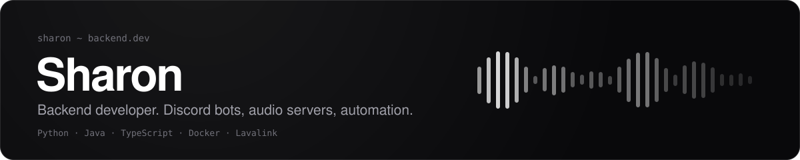
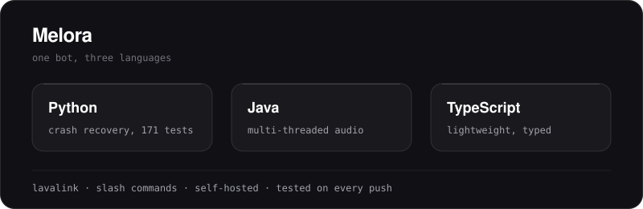
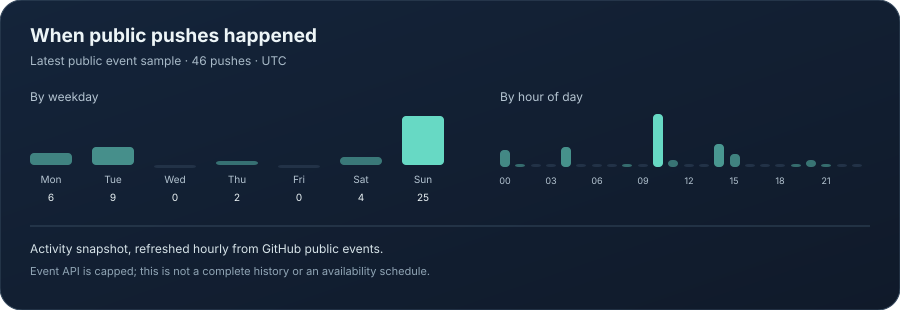

I'm a backend developer from India. I mostly write Python, Java and TypeScript, and I like building things that keep running without me watching them: Discord music bots, audio servers, automation. I also run [AvarathyGaming](https://www.youtube.com/@AvarathyGaming), a Malayalam Minecraft horror channel.

[Portfolio](https://sharon-ctl.github.io/) · [YouTube](https://www.youtube.com/@AvarathyGaming) · [Discord](https://discord.com/invite/KUAVNSJtu5) · [Instagram](https://instagram.com/sharon__y_)

## Projects

**[Melora](https://github.com/Sharon-ctl/Melora.py)** is a Discord music bot I wrote three times. The Python version is built to run unattended, with crash-recovery supervisors, health watchdogs, a sliding-window rate limiter and 171 tests that run on every push. [Java](https://github.com/Sharon-ctl/Melora-Java) handles audio across many servers at once with multiple threads. [TypeScript](https://github.com/Sharon-ctl/Melora.js) is the small, typed one with slash commands.

**[Online-Fix Tracker](https://github.com/Sharon-ctl/Online-fix-request-sending-dc-bot)** polls an RSS feed, drops duplicates, translates the Russian posts into English and sends them to Discord.

**[YTDL Toolkit](https://github.com/Sharon-ctl/YT-Downloader-)** is a PowerShell front end for yt-dlp and FFmpeg where you pick the video and audio formats you want.

More on the [portfolio](https://sharon-ctl.github.io/#projects) or [all repositories](https://github.com/Sharon-ctl?tab=repositories).

## Status

Build status of my own repos, refreshed hourly from the GitHub API.

<!-- PROJECT_STATUS:START -->
| Project | CI / checks | Last push (UTC) | Open issues / PRs |
| --- | --- | --- | ---: |
| [Melora-Java](https://github.com/Sharon-ctl/Melora-Java) | [Passing (CI)](https://github.com/Sharon-ctl/Melora-Java/actions/runs/45877217559) | 2026-11-17 | 2 |
| [Melora.js](https://github.com/Sharon-ctl/Melora.js) | [Passing (CI)](https://github.com/Sharon-ctl/Melora.js/actions/runs/45876372141) | 2026-11-17 | 1 |
| [Melora.py](https://github.com/Sharon-ctl/Melora.py) | [Passing (CI)](https://github.com/Sharon-ctl/Melora.py/actions/runs/45875758349) | 2026-11-23 | 1 |
| [Online-fix-request-sending-dc-bot](https://github.com/Sharon-ctl/Online-fix-request-sending-dc-bot) | [Passing (CI)](https://github.com/Sharon-ctl/Online-fix-request-sending-dc-bot/actions/runs/43989659317) | 2026-11-17 | 0 |
| [Sharon-ctl.github.io](https://github.com/Sharon-ctl/Sharon-ctl.github.io) | [Passing (pages-build-deployment)](https://github.com/Sharon-ctl/Sharon-ctl.github.io/actions/runs/45762833461) | 2026-11-26 | 0 |
| [YT-Downloader-](https://github.com/Sharon-ctl/YT-Downloader-) | No CI configured | 2026-11-17 | 0 |
<!-- PROJECT_STATUS:END -->

## Stack

- **Languages:** Python, Java, TypeScript, JavaScript, PowerShell, SQL
- **Frameworks:** discord.py, JDA, Lavalink, Lavaplayer, asyncio, Pytest
- **Tools:** Docker, GitHub Actions, Git, FFmpeg, yt-dlp, SQLite

## Contact

Discord is the quickest way to reach me: [join the server](https://discord.com/invite/KUAVNSJtu5).
