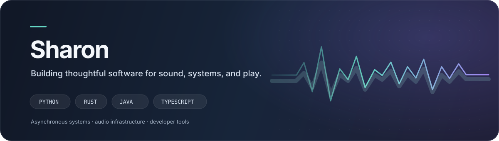
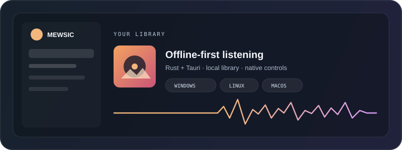
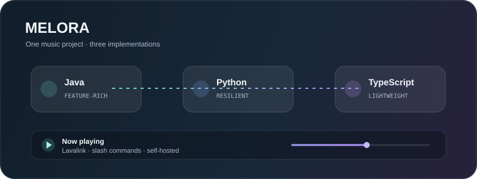
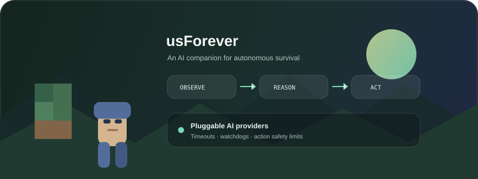

  
   
  
  
  

## Hi, I'm Sharon

I build software around **real-time audio, resilient services, and useful developer tools**. My projects range from cross-platform desktop media software to Discord music systems and experiments with autonomous game agents.

I care about the details that make software dependable: clear interfaces, responsive async systems, thoughtful failure handling, and practical performance work.

## Featured projects

<table>
  <tr>
    <td width="50%" valign="top">
      
      <h3><a href="https://github.com/Sharon-ctl/Mewsic">Mewsic</a></h3>
      
Offline-first desktop music player built with Rust, Tauri, and React. Includes a fast local library, broad audio metadata support, native media controls, and integrated search and downloads.

      
<code>Rust</code> <code>Tauri</code> <code>React</code> <code>TypeScript</code>

    </td>
    <td width="50%" valign="top">
      
      <h3><a href="https://github.com/Sharon-ctl/Melora.py">Melora music bots</a></h3>
      
A family of self-hosted Discord music bots in Python, Java, and TypeScript. The Python edition focuses on multi-node Lavalink resilience and recovery; Java offers a deep feature set; TypeScript keeps the core experience lightweight.

      
<a href="https://github.com/Sharon-ctl/Melora.py">Python</a> · <a href="https://github.com/Sharon-ctl/Melora-Java">Java</a> · <a href="https://github.com/Sharon-ctl/Melora.js">TypeScript</a>

    </td>
  </tr>
  <tr>
    <td width="50%" valign="top">
      
      <h3><a href="https://github.com/Sharon-ctl/usForever">usForever</a></h3>
      
An experimental autonomous Minecraft companion. A LangGraph observe–reason–act loop connects pluggable model providers to in-game tools, with timeouts, watchdogs, and action limits to keep behavior bounded.

      
<code>Node.js</code> <code>LangGraph</code> <code>Minecraft</code> <code>LLMs</code>

    </td>
    <td width="50%" valign="top">
      <h3><a href="https://github.com/Sharon-ctl/YT-Downloader-">YTDL Toolkit</a></h3>
      
A Windows media workflow built around yt-dlp and FFmpeg. A guided interface handles downloads, playlists, subtitles, metadata, format choices, and maintenance.

      
<code>PowerShell</code> <code>yt-dlp</code> <code>FFmpeg</code>

      <h3><a href="https://github.com/Sharon-ctl/Online-fix-request-sending-dc-bot">Online-Fix Tracker</a></h3>
      
A Discord bot that monitors a game-release RSS feed, translates updates, and delivers searchable, paginated posts to configured channels.

      
<code>Python</code> <code>Discord</code> <code>RSS</code>

    </td>
  </tr>
</table>

## What I work with

  
  
  
  
  
  
  
  
  
  

**Areas I enjoy:** asynchronous systems · audio and media pipelines · bot architecture · desktop applications · automation · reliability and performance

## Find me

- Browse [all repositories](https://github.com/Sharon-ctl?tab=repositories)
- Connect on [Discord](https://discord.gg/KUAVNSJtu5)

  Thanks for stopping by — feel free to explore, open an issue, or say hello.

