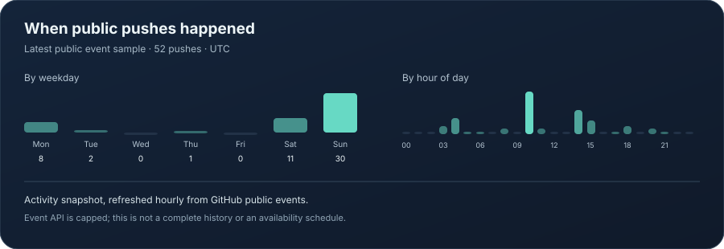

  
   
  
  
  

  <a href="#original-projects">Projects</a> &nbsp;·&nbsp; <a href="#live-project-status">Project status</a> &nbsp;·&nbsp; <a href="#recent-work-pattern">Activity</a> &nbsp;·&nbsp; <a href="#contact">Contact</a>

## Hi, I'm Sharon

I build software around **real-time audio, resilient services, and useful developer tools**. I care about responsive async systems, thoughtful failure handling, and interfaces that make complex tools easy to use.

## Original projects

These are my original public projects; forked repositories are left out.

<table>
  <tr>
    <td width="50%" valign="top">
      
      <h3><a href="https://github.com/Sharon-ctl/Melora.py">Melora music bots</a></h3>
      
A family of self-hosted Discord music bots. Python focuses on multi-node Lavalink resilience and recovery; Java offers a broad feature set; TypeScript keeps the core experience lightweight.

      
<a href="https://github.com/Sharon-ctl/Melora.py">Python</a> · <a href="https://github.com/Sharon-ctl/Melora-Java">Java</a> · <a href="https://github.com/Sharon-ctl/Melora.js">TypeScript</a>

    </td>
    <td width="50%" valign="top">
      <h3><a href="https://github.com/Sharon-ctl/YT-Downloader-">YTDL Toolkit</a></h3>
      
A Windows media workflow built around yt-dlp and FFmpeg, with guided downloads, playlists, subtitles, metadata, format choices, and maintenance.

      
<code>PowerShell</code> <code>yt-dlp</code> <code>FFmpeg</code>

      <h3><a href="https://github.com/Sharon-ctl/Online-fix-request-sending-dc-bot">Online-Fix Tracker</a></h3>
      
A Discord bot that monitors game-release RSS updates, translates them, and posts searchable, paginated updates to configured channels.

      
<code>Python</code> <code>Discord</code> <code>RSS</code>

    </td>
  </tr>
</table>

## Live project status

<!-- PROJECT_STATUS:START -->
| Project | CI / checks | Last push (UTC) | Open issues / PRs |
| --- | --- | --- | ---: |
| [Melora-Java](https://github.com/Sharon-ctl/Melora-Java) | [Passing (CI)](https://github.com/Sharon-ctl/Melora-Java/actions/runs/40349201237) | 2026-10-26 | 2 |
| [Melora.js](https://github.com/Sharon-ctl/Melora.js) | [Passing (CI)](https://github.com/Sharon-ctl/Melora.js/actions/runs/40347999241) | 2026-10-27 | 1 |
| [Melora.py](https://github.com/Sharon-ctl/Melora.py) | [Passing (CI)](https://github.com/Sharon-ctl/Melora.py/actions/runs/40346840023) | 2026-10-26 | 1 |
| [Online-fix-request-sending-dc-bot](https://github.com/Sharon-ctl/Online-fix-request-sending-dc-bot) | No CI configured | 2026-06-28 | 0 |
| [YT-Downloader-](https://github.com/Sharon-ctl/YT-Downloader-) | No CI configured | 2026-08-04 | 0 |
<!-- PROJECT_STATUS:END -->

Status is refreshed hourly from GitHub for original public repositories only. Forks and this profile repository are excluded.

## Recent work pattern

  

This chart summarizes timestamps from the latest public GitHub events available to the profile updater. It describes **when public pushes appeared**, not a work schedule or availability promise. Times are UTC; GitHub limits the event sample, so this is a recent snapshot rather than a complete lifetime history.

## What I work with

  
  
  
  
  
  
  
  

**Areas I enjoy:** asynchronous systems · audio and media pipelines · bot architecture · automation · reliability and performance

## Contact

Open to interesting work and collaboration. [Get in touch on Discord](https://discord.gg/KUAVNSJtu5) or [browse my projects](https://github.com/Sharon-ctl?tab=repositories).

  Thanks for stopping by — feel free to explore, open an issue, or say hello.

